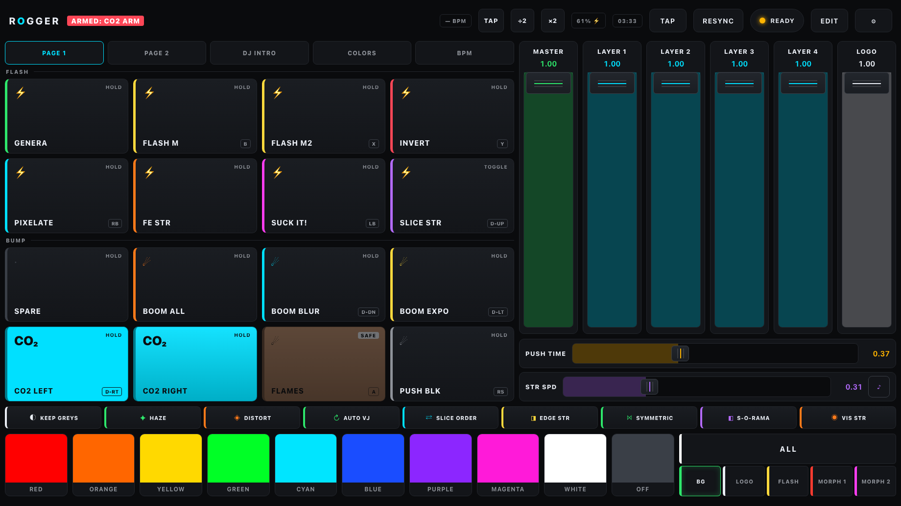
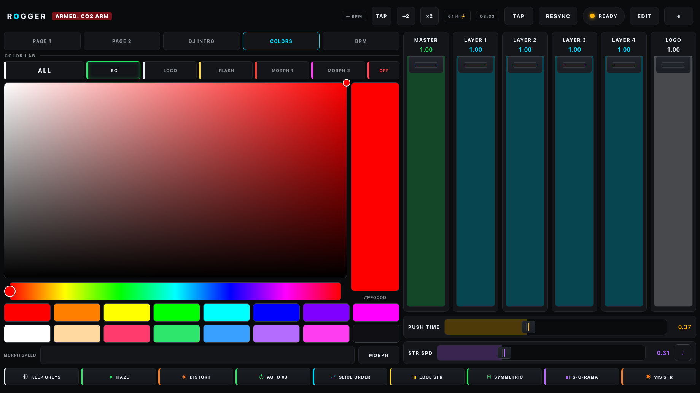
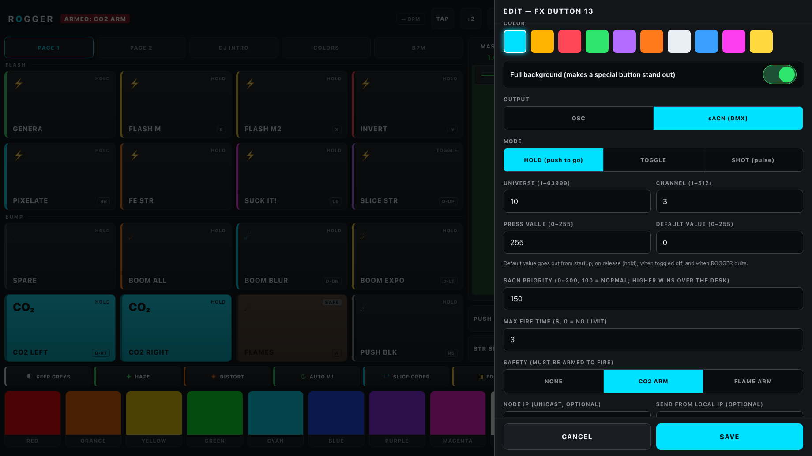
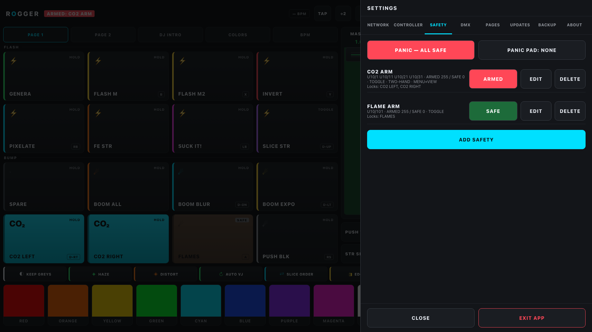
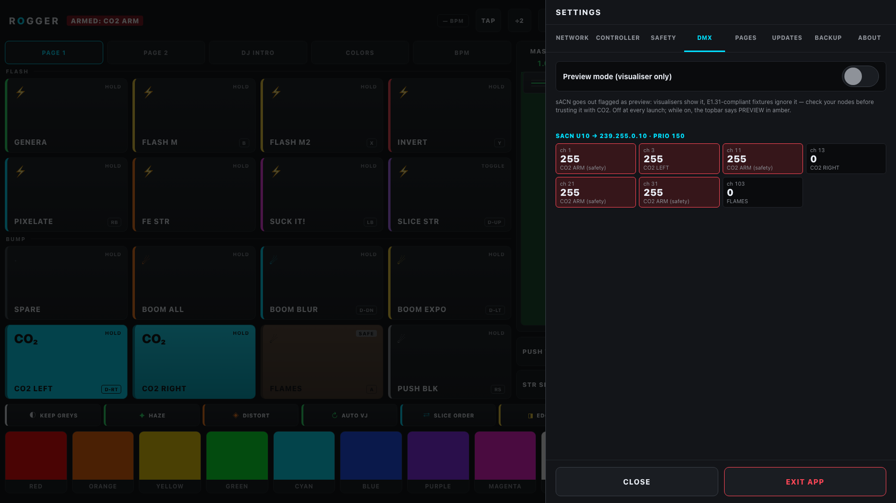

<strong>ROGGER</strong>

A touchscreen performance remote for Resolume Arena, built on the ASUS ROG Ally X, at home on any Windows handheld.

---

Resolume's own UI is made for the studio. ROGGER is made for the moment the room is dark, the bass drops, and you want the next hit under your thumb, not under a mouse.

**Every FX one tap away.** Flash, invert, pixelate, slice strobe, boomer and pusher bumps on a finger-sized grid. Hold to fire, release to clear, and beat-synced repeats that follow your tap tempo.

**A real controller, not a touch imitation.** The Ally's sticks pan and zoom the composition, the analog triggers duck the master or stomp a strobe by how hard you pull them, and every face button carries a hit. Hold a bumper or a trigger and the same four buttons become a second layer of pushers. Rumble on every press.

**Colour on the fly.** Pick a colour once and it lands on the background, the logos or the strobes, whichever you choose. Quick swatches, a full picker, and presets that remember what you last sent.

**It knows your show.** Reads the composition over Resolume's web API to name your clips, checks that every button reaches something real, and tells you in plain words when a leg of the link is down and what to type to fix it.

**Fire the specials, safely.** Any button can send sACN instead of OSC, so CO2 jets, spark machines and flame units sit next to the visuals. Hold for push-to-go, toggle, or a timed shot, with a maximum fire time. Safety switches arm whole banks of machines: SAFE at every launch, two-hand arming if you want it, a greyed-out button that refuses to fire while its safety is off, and one PANIC that drops everything back to safe. Preview mode sends the whole thing to your visualiser while the real machines ignore it, and a live DMX monitor shows every channel ROGGER drives.

**Runs on whatever is in your hands.** ROGGER is a Windows app with a standard gamepad and a touchscreen in mind, not a single device. The ASUS ROG Ally X is where it was built and tested; the ROG Ally, Lenovo Legion Go, MSI Claw, a Steam Deck running Windows, or any Windows tablet or laptop with touch and an Xbox-style controller should work the same, and the layout scales itself to the screen. It needs Windows (x64): SteamOS and macOS are not supported as player machines.

**Built for the road.** Full screen, no menus, no sleep. Updates arrive over the air as a 100 KB payload, never mid-show, always with a way back. A grandMA3 fixture profile is included for desks that want to drive it over DMX.

<table>
  <tr>
    <td width="50%"> <b>Colour lab</b> — one pick lands on the background, the logos or the strobes.</td>
    <td width="50%"> <b>sACN buttons</b> — universe, channel, press and default level, priority, max fire time, the safety it needs.</td>
  </tr>
  <tr>
    <td width="50%"> <b>Safety switches</b> — whole banks of machines, SAFE at launch, two-hand arming, PANIC.</td>
    <td width="50%"> <b>DMX monitor</b> — every channel ROGGER drives, live, with preview mode for rehearsals.</td>
  </tr>
</table>

  <a href="https://github.com/riegergogi2001/resolume-rogger/releases/latest"><strong>Download the latest release</strong></a>

Open the exe, point Settings → Network at the machine running Resolume, run Test connection, and play.

---

Made by Rieger Gergő. Developer notes, testing and the MA3 handoff live in [docs/DEVELOPMENT.md](docs/DEVELOPMENT.md). MIT licensed.
